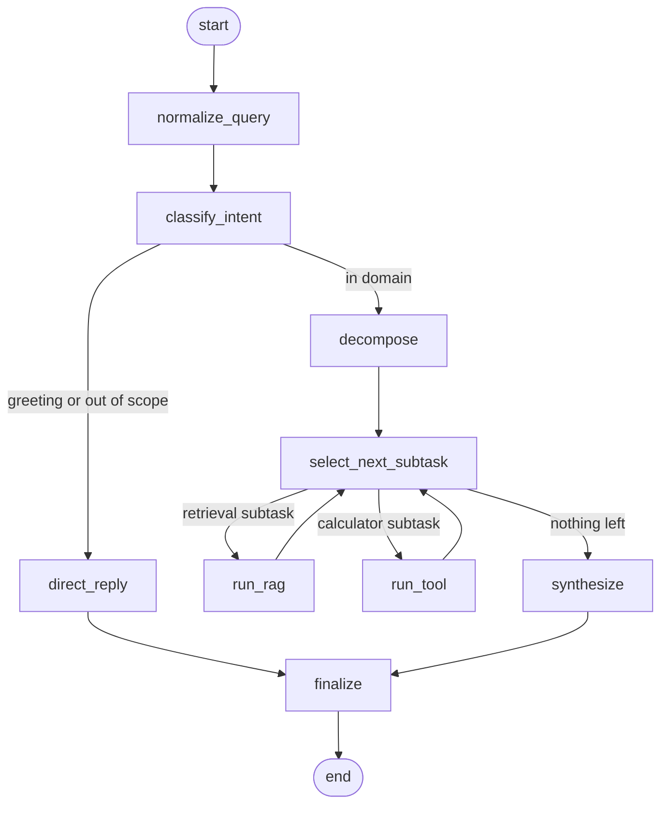

# Podoba Transit — Customer Service Helpdesk

Agentic RAG chatbot for a fictional regional public-transport operator. A passenger or a station agent asks about fares, tickets, refunds, delay compensation, accessibility, complaints, lost property, or onboard safety. The assistant decides whether the question is in scope, splits a multi-part question, retrieves the governing rule or runs a calculator, and returns a cited answer.

The policy set was written for this prototype. It is not the rulebook of a real operator, and it does not create a refund, a compensation decision, or a penalty notice.

## Problem and objective

### Why this problem is relevant

Passenger questions are frequent, document-bound, and expensive to get wrong. A refund window, a penalty fare, or a compensation band is a specific rule. A general chatbot will invent a number when the rulebook is silent. The same desk also receives questions whose answer is not a sentence in the rulebook: the price of a 3-zone ticket, or the compensation due on a 45-minute delay, has to be calculated from the published tariff and the facts in the question.

### What user need it satisfies

A passenger, or a station agent speaking with one, can ask in everyday language and see the rule, the source section, and, when the question contains zones or a delay, the calculated amount. High-impact claims still go to station staff. Every in-domain answer says so:

> This assistant summarizes Podoba Transit customer rules for information only. It does not create a refund, a compensation decision, or a penalty notice. Station staff confirm claims and exceptions.

### Why an agentic RAG approach fits

One retrieval call is enough for "How long is a single ticket valid?". It is the wrong shape for the rest of the desk:

- Some questions contain two independent rules and have to be split. Each part is executed on its own text.
- A zone fare is a formula. `4.80 EUR` for an adult 3-zone single does not occur anywhere in the corpus. The fare tool reads 2.40 EUR and 1.20 EUR from `POL-FARE` and applies them to the zone count.
- Delay compensation depends on minutes late, the ticket price, and whether a strike was announced at least 48 hours ahead. The amount is calculated from `POL-DELAY`, then tied back to that section.
- Greetings and questions outside the desk should not become a policy search.

The graph routes those cases. Retrieval is one branch.

## Architecture

The parent LangGraph workflow has nine nodes. Conditional edges after classification and after each subtask are the decision points. A subtask receives only its own query. Sibling answers live in `intermediate_results`, and only `synthesize` reads that list.



`run_rag` calls a second, compiled graph. Those five nodes are not nodes of the parent:

1. `prepare_query` expands `PRM` and `ITO`.
2. `retrieve` runs BM25 over section chunks.
3. `grade_documents` rescores by lexical coverage and drops the glossary unless the user asked what a term means.
4. `broaden_query` runs only when the best coverage is below 0.2, and only once. It appends the policy section titles and retrieves again.
5. `draft_answer` calls the model interface and keeps the source section.

State that matters:

| Field | Role |
| --- | --- |
| `query` | Original question, whitespace collapsed |
| `working_query` | Same question after a few surface synonyms (`bike` becomes `bicycle`) |
| `intent` | Routing decision |
| `subtasks` | Independent pieces of work, each with its own query and status |
| `current_subtask` | The piece selected for this step |
| `intermediate_results` | One answer record per finished subtask |
| `passages` | Graded chunks shown in the UI |
| `trace` | Node name, detail, and milliseconds, including RAG child steps |
| `citations` | Sections actually used in the answer |

### Tools

Retrieval is the RAG subgraph. Two further tools do work that retrieval cannot:

- `calculate_fare` reads the zone count and whether the passenger is a child. The zone 1 price, the extra-zone price, and the child half-fare are parsed from `POL-FARE` and quoted back, so the tool cannot drift from the tariff. An adult single is 2.40 EUR in zone 1 plus 1.20 EUR per extra zone. A child single is half of that adult fare, rounded half-up to the cent. "3 zones" and "for zone 3" both reach the tool. "in zone 1" stays a lookup, because that price is already a sentence.
- `assess_delay_compensation` reads the minute bands and the strike rule from `POL-DELAY`. Under 30 minutes pays nothing. From 30 to 59 minutes pays 50 percent. From 60 minutes pays 100 percent. A strike pays nothing only when the question states that it was announced at least 48 hours in advance. A shorter notice stays on the minute band.

Routing is deterministic Python. A helpdesk should keep scope and tool choice stable when the answer model changes.

### Data

Nine Markdown policies live in `corpus/policies/`. The loader reads YAML-style front matter, splits on `##` headings, and builds one chunk per section (28 chunks). Adding a policy is a new file. The BM25 index is built once when the service starts.

| Document | What it holds |
| --- | --- |
| `POL-FARE` | Zone tariff, child half-fare, day cap, Senior Card |
| `POL-TICKET` | 90-minute validity, transfers, 60 EUR penalty fare |
| `POL-REFUND` | 14-day unused-ticket refund, 5 EUR season-ticket fee, lost tickets |
| `POL-DELAY` | Compensation bands, 28-day claim window, announced strikes |
| `POL-ACCESS` | Assistance booked 2 hours ahead, wheelchair spaces, priority seats |
| `POL-COMPLAINT` | 5 working days, 20 working days, Independent Travel Ombudsman |
| `POL-LOST` | 30-day holding period, photo identification, no collection fee |
| `POL-SAFE` | Emergency intercom, doors, bicycles, unattended luggage |
| `POL-GLO` | `PRM`, `ITO` |

BM25 is the default retriever because the corpus is small and the answers are exact phrases ("90 minutes", "5 working days", "60 EUR"). A dense index can replace `BM25Retriever.search` without changing the graph.

### Model choice

The default model is `dummy-extractive-v1`. It returns the sentence in the top graded passage that covers the question best. It cannot invent a fare or a compensation amount. Those amounts come from the tools, which quote the rule they applied.

This host is a CPU-only WSL2 machine with 12 cores and 7.6 GiB of RAM. A small local instruct model such as Flan-T5-small would fit, and `LLM_BACKEND=transformers` selects `google/flan-t5-small` when `transformers` and `torch` are installed. That stack is intentionally absent from `requirements.txt`, because a downloadable checkpoint makes the prototype harder to reproduce and a generative call on CPU would dominate latency. The extractive model stays faithful to the sentence it was given.

Trade-off: answers stay fast and stay inside the source sentence, so they read like the policy. Routing does not call the model, so swapping the backend does not change which tool runs.

### Interface

- Streamlit (`src/ui/app.py`) shows the answer, the intent, the latency, the agent trace (including RAG child steps), each subtask, and the graded passages.
- FastAPI (`src/api/main.py`) exposes `GET /health` and `POST /chat`.
- `docker compose up --build` runs the API and the UI. The UI calls the API through `AGENT_API_URL`.
- The UI can also run the graph in-process when `AGENT_API_URL` is unset.

## Functional evaluation

`eval/questions.json` holds 20 questions. A case passes when the intent matches, every required phrase is present, forbidden phrases are absent, and the expected document ids appear in the citations. Greetings and out-of-scope questions must not cite a policy.

Command: `python eval/functional_eval.py`

Result on this host: **20 of 20 passed**. Intent accuracy 100%, required-phrase accuracy 100%, citation accuracy 100%. Mean latency across the 20 questions was 11.8 ms. The raw report is `eval/results/functional_report.json`.

The same 20 questions were also sent straight to the RAG subgraph, with the router and the calculators removed. That baseline passed **12 of 20**. Required-phrase accuracy was 0.60 and citation accuracy was 0.85. The 12 passes are the single-section policy questions (`q01`–`q12`). The 8 failures are the questions that need a split, a calculation, or a refusal (`q13`–`q20`).

| ID | Question | Intent | Answer | Source |
| --- | --- | --- | --- | --- |
| q01 | How long is a single ticket valid? | policy lookup | A single ticket is valid for 90 minutes from the time of purchase. | POL-TICKET — Single ticket validity |
| q02 | What does an adult single ticket cost in zone 1? | policy lookup | An adult single ticket costs 2.40 EUR in zone 1. | POL-FARE — Adult single tickets |
| q03 | How long is lost property kept? | policy lookup | Lost property is kept for 30 days. | POL-LOST — Holding period |
| q04 | What is the penalty fare for travelling without a valid ticket? | policy lookup | A passenger without a valid ticket must pay a penalty fare of 60 EUR. | POL-TICKET — Penalty fare |
| q05 | How quickly must passenger assistance be booked before departure? | policy lookup | Passenger assistance must be booked at least 2 hours before departure. | POL-ACCESS — Booking passenger assistance |
| q06 | Within how many days can an unused single ticket be refunded? | policy lookup | An unused single ticket can be refunded within 14 days of purchase. | POL-REFUND — Unused single tickets |
| q07 | What is the administration fee kept on a season ticket refund? | policy lookup | Podoba Transit keeps an administration fee of 5 EUR on a season ticket refund. | POL-REFUND — Season ticket refunds |
| q08 | How fast is the first response to a complaint? | policy lookup | Podoba Transit sends a first response to a complaint within 5 working days. | POL-COMPLAINT — First response |
| q09 | When is the final response to a complaint sent? | policy lookup | A final response to a complaint is sent within 20 working days. | POL-COMPLAINT — Final response |
| q10 | Are bicycles allowed on trains arriving in the city centre between 07:30 and 09:30? | policy lookup | Bicycles are not allowed on trains arriving in the city centre between 07:30 and 09:30. | POL-SAFE — Bicycles |
| q11 | What does PRM stand for? | policy lookup | PRM means passenger with reduced mobility. | POL-GLO — PRM |
| q12 | For how many minutes does a single ticket stay valid after purchase? | policy lookup | A single ticket is valid for 90 minutes from the time of purchase. | POL-TICKET — Single ticket validity |
| q13 | How long is a single ticket valid, and how long is lost property kept? | multi-part | Part 1: valid for 90 minutes. Part 2: kept for 30 days. | POL-TICKET — Single ticket validity; POL-LOST — Holding period |
| q14 | How much is an adult single ticket for 2 zones, and how long is lost property kept? | multi-part | Part 1: 3.60 EUR. Part 2: kept for 30 days. | POL-FARE — Adult single tickets; POL-LOST — Holding period |
| q15 | How much is an adult single ticket for 3 zones? | fare calculator | An adult single ticket for 3 zones costs 4.80 EUR. | POL-FARE — Adult single tickets |
| q16 | How much is a child single ticket for 4 zones? | fare calculator | A child single ticket for 4 zones costs 3.00 EUR. The adult fare for 4 zones is 6.00 EUR. | POL-FARE — Adult single tickets; POL-FARE — Child fares |
| q17 | The train was 45 minutes late and the ticket cost 8.00 EUR. How much compensation do I get? | delay calculator | The compensation is 4.00 EUR, which is 50 percent of 8.00 EUR. | POL-DELAY — Compensation thresholds |
| q18 | The train was 12 minutes late and the ticket cost 6.40 EUR. How much compensation do I get? | delay calculator | The delay does not qualify. The compensation amount is 0.00 EUR. | POL-DELAY — Compensation thresholds |
| q19 | Hello, who are you? | chitchat | I am the Podoba Transit customer service assistant. I answer questions about fares, tickets, refunds, delay compensation, accessibility, complaints, lost property, and onboard safety, and I cite the rule I use. | none |
| q20 | What will the weather be in Budapest tomorrow? | out of scope | That question is outside Podoba Transit customer service. I can help with fares, tickets, refunds, delay compensation, accessibility, complaints, lost property, and onboard safety. | none |

In-domain answers also end with the disclaimer quoted above. It is omitted from the table.

What the comparison shows:

- `q12` is a paraphrase of `q01` (`stay valid after purchase` versus `valid for 90 minutes from the time of purchase`) and still lands on the same sentence.
- `q13` asked to the subgraph alone returns the lost-property rule and misses "90 minutes". The parent graph splits the question and retrieves each section separately.
- `q15` and `q16` cite the tariff, and the figures 4.80 EUR and 3.00 EUR are computed. A retrieval-only call cannot emit 4.80 EUR, because that string is not in the corpus. The same is true of 3.60 EUR, 4.00 EUR, and 6.00 EUR.
- `q19` and `q20` never search.

Two further rules are covered by the tests and are outside the 20-question set. "How many days do I have to submit a delay compensation claim?" returns "within 28 days of the journey" from `POL-DELAY — Claim window`. "Is compensation paid when a strike was announced 48 hours in advance?" returns the announced-strike exclusion. A 70-minute delay with a strike announced 48 hours ahead is calculated as 0.00 EUR. The same delay announced 2 hours ahead stays on the minute band and pays the full fare.

The score is high because the control flow is deterministic and the extractive model copies policy sentences. The set is small and written against this corpus. A question that shares almost no words with the policy, or that uses a fare shape the router does not recognize, will miss. That limit is lexical. A later version would add a dense retriever beside BM25, and would keep the same tools.

## Performance test

`python eval/load_test.py` sends 150 queries after 5 warmup queries. The bank is the 20 evaluation questions, cycled. The run is in-process, so it measures the agent rather than HTTP or Streamlit. Full numbers are in `eval/results/load_test.json`. Figures below are one run on this WSL2 host (12 cores, 7.6 GiB RAM, Python 3.10.12). Absolute milliseconds will move on another machine.

Cold run, answer cache off (`AGENT_CACHE_SIZE` unset):

| Metric | Value |
| --- | --- |
| Mean | 11.2 ms |
| Median | 10.3 ms |
| p95 | 22.0 ms |
| Min | 1.9 ms |
| Max | 36.9 ms |
| Throughput | 89 queries/s |

Latency by intent on that cold run:

| Intent | Queries | Mean | p95 |
| --- | --- | --- | --- |
| policy lookup | 94 | 12.1 ms | 19.6 ms |
| multi-part | 14 | 18.6 ms | 32.3 ms |
| fare calculator | 14 | 7.3 ms | 12.0 ms |
| delay calculator | 14 | 7.5 ms | 11.2 ms |
| chitchat | 7 | 5.4 ms | 10.3 ms |
| out of scope | 7 | 5.7 ms | 11.9 ms |

Second pass with `cache_size=256`. The warmup leaves 5 of the 20 questions cached, so the timed 150 queries contain 15 misses and 135 hits:

| Metric | Value |
| --- | --- |
| Mean | 1.7 ms |
| Median | 0.0 ms |
| p95 | 15.4 ms |
| Max | 33.8 ms |
| Throughput | 593 queries/s |

A hit skips the graph, which is why the median is 0.0 ms. The p95 is the questions that were still cold.

### Bottleneck

On the cold run the parent step `run_rag` accounts for 591 ms across 115 calls (mean 5.1 ms). The next parent step, `classify_intent`, accounts for 13 ms across all 150 calls. `run_tool` accounts for 3.3 ms across 35 calls. Multi-part questions are the slowest intent because each one walks the parent loop twice and still calls `run_rag`.

Inside `run_rag`, the subgraph bodies are small: `retrieve` 44 ms total (mean 0.38 ms), `grade_documents` 24 ms, `draft_answer` 11 ms, `prepare_query` 4 ms. Together that is 84 ms. The other 507 ms, about 86% of `run_rag`, is the cost of invoking the nested compiled graph. `broaden_query` did not run on this mix. The retry path is real — an unknown query such as "purple widgets" broadens once and then stops — and it is not the hot path.

The main bottleneck is nested LangGraph invocation on the retrieval branch, not BM25 and not the calculators.

### Optimization suggestions

1. Turn on the answer cache for repeated passenger questions. `AGENT_CACHE_SIZE=256` is already wired into the API and the UI. On this repeated mix it raised throughput from 89 to 593 queries/s. Cache keys are the normalized question. When the cache is full it drops the least recently used question. Clear the process when the corpus changes, because the cache does not watch the files.
2. Keep the RAG subgraph as the module the parent and the baseline call, and call its steps directly on the common path. The bodies of `retrieve`, `grade_documents`, and `draft_answer` finish in under 1 ms combined. Invoking them as plain functions from `run_rag`, and entering the compiled retry only when coverage is below 0.2, would remove the 507 ms of nested graph scheduling from a 150-query cold run. Caching BM25 hits would save less: retrieval itself averages 0.38 ms.

A generative CPU model would move the bottleneck onto token generation and would be able to state a fare that is not in the passage. The extractive default avoids that. If a later version needs rewritten prose, the generator should sit behind the same citation check and the calculators should still own the arithmetic.

## Installation and run

Python 3.10 or newer.

From the repository root, on any machine:

```bash
python3 -m venv .venv
source .venv/bin/activate
pip install -r requirements-dev.txt
```

Some Ubuntu images ship Python without `ensurepip`, and `python3 -m venv` then fails. `bash scripts/setup_venv.sh` builds the venv from the repository root (the script does not depend on this checkout path), bootstraps pip, and installs `requirements-dev.txt`. It deletes an existing `.venv`.

Run the tests, the evaluation, and the load test:

```bash
pytest
python eval/functional_eval.py
python eval/load_test.py
```

Ask one question:

```bash
PYTHONPATH=src python -m podoba_helpdesk "How long is a single ticket valid?"
```

UI and API on the host:

```bash
PYTHONPATH=src streamlit run src/ui/app.py
PYTHONPATH=src uvicorn api.main:app --host 0.0.0.0 --port 8000
```

The UI listens on port 8501 on every interface. On the same machine, point it at the API with `AGENT_API_URL=http://127.0.0.1:8000`. Set `AGENT_CACHE_SIZE` to an integer above 0 to enable the answer cache. A non-numeric value is ignored. Set `LLM_BACKEND=transformers` only after installing `transformers` and `torch`.

Docker Compose builds one image and runs both processes. The API listens on `0.0.0.0:8000` inside the container and the UI on `0.0.0.0:8501`. Compose publishes both ports on every host interface (`0.0.0.0`), so another machine opens `http://<host-ip>:8501`. The UI calls `http://api:8000`, which is the Compose service name.

```bash
docker compose up --build
curl -s http://127.0.0.1:8000/health
```

On a network that already trusts PyPI, leave `docker/extra-ca/` without a certificate file. If a TLS proxy replaces the PyPI certificate, put that proxy's CA bundle in the directory as a `.crt` file before building. Those files are gitignored. The image build appends every `*.crt` it finds there to the trust store and points pip at it. `HTTP_PROXY` and `HTTPS_PROXY`, when set in the build environment, are declared build arguments so pip can use them. The running container does not keep the proxy and does not download model weights.

## Layout

```
corpus/policies/          nine passenger-rule documents
src/podoba_helpdesk/    graph, RAG subgraph, tools, retriever, service
src/api/main.py           FastAPI
src/ui/app.py             Streamlit
eval/questions.json       20-question set
eval/functional_eval.py   full workflow and retrieval-only baseline
eval/load_test.py         150-query load test
eval/results/             reports from the run documented above
tests/                    planner, tools, graph, answers, API
Dockerfile                single image, API and UI
docker-compose.yml        api + ui
docker/extra-ca/          optional build-time CA bundle; *.crt is gitignored
```
